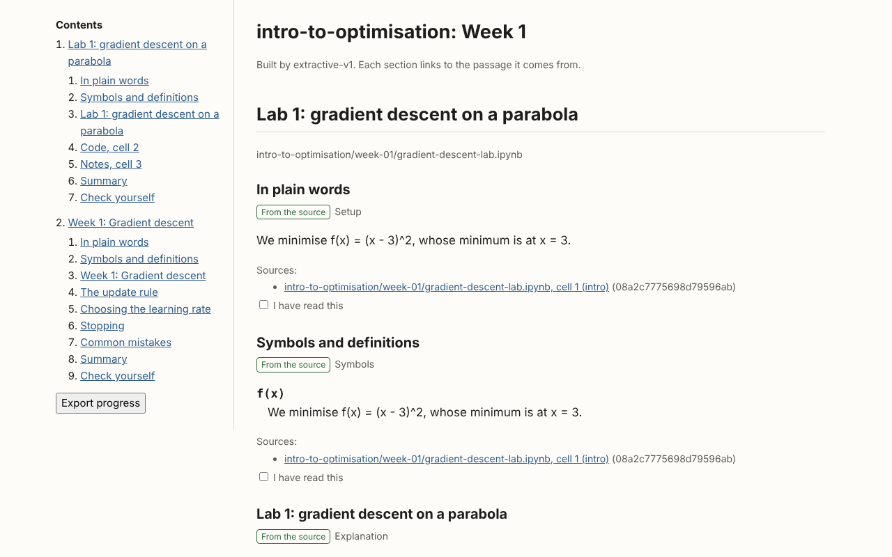
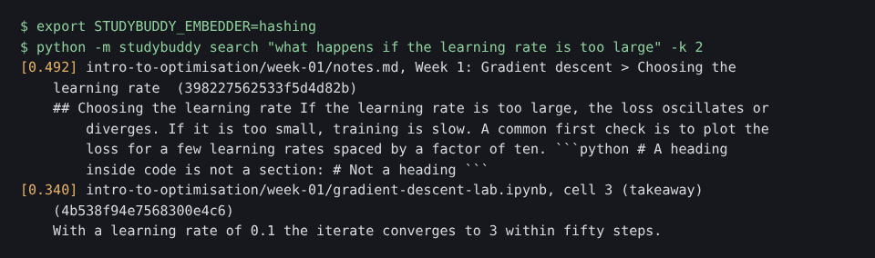
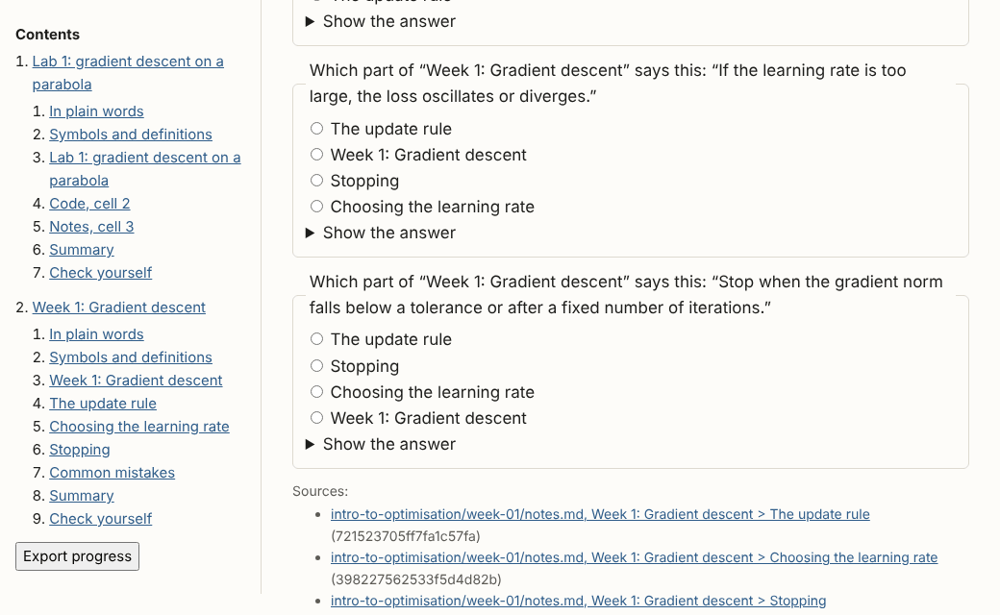
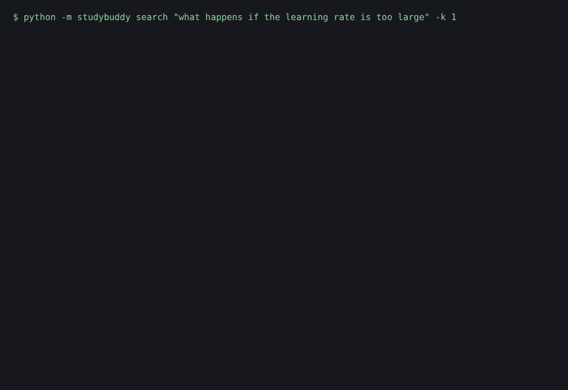
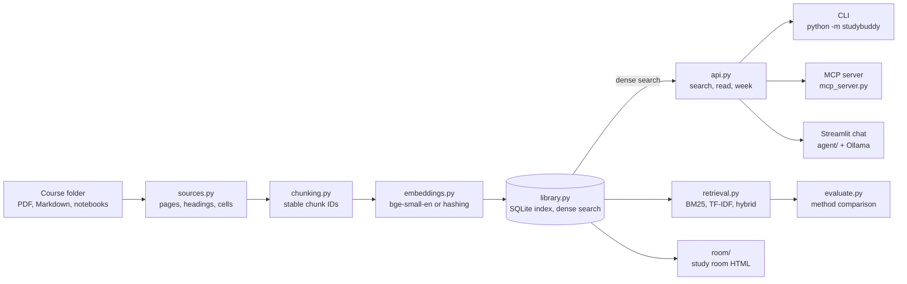

# Study Buddy

**Status: prototype.** Import, search, citations, and study rooms work offline and are tested; the chat needs a local Ollama model, and the evaluation's relevance labels are still provisional.

Course material is spread across slides, notes, and lab notebooks, and a search tool that cannot say where an answer came from is hard to trust while studying. Study Buddy imports a folder of course files once, then lets you search it, read a week as one study page, and quiz yourself, with every passage linked back to its PDF page, Markdown heading, or notebook cell.



## What it does today

- **Imports PDF, Markdown, and Jupyter files** into a local SQLite index. Re-importing only re-reads changed files, and notebook code is never run.
- **Searches with citations.** Every result names its file, course, week, and location (page, heading path, or cell). Search works from the command line, the Streamlit chat, and an MCP server for Claude.
- **Builds a study room per week:** one HTML page with setup, symbols, the source passages, a summary, and a quiz. Each section links to the passage it quotes, and progress is saved in the browser.
- **Compares retrieval methods** (dense, BM25, TF-IDF, and hybrid) on 44 labelled queries, with a fixed rule for when hybrid is worth adopting.

| Search with a citation | Answer a quiz question, then open its source |
|---|---|
|  |  |

Asking from the command line, then opening the full passage and its citation:



These runs used the offline `hashing` embedder, so the scores are lexical, not semantic. Free-form questions in the chat app need a local Ollama model, which this repo's cloud checks do not run.

## Quickstart

This path needs only Python 3.12. It uses the offline embedder and the sample course in `sample_course/`, so nothing is downloaded and no model runs.

```bash
git clone https://github.com/KoalaLyfestyle/Study-Buddy.git
cd Study-Buddy
python3.12 -m venv .venv && source .venv/bin/activate
pip install -r requirements-dev.txt
export STUDYBUDDY_EMBEDDER=hashing

python -m studybuddy import sample_course
# 3 added, 0 updated, 0 unchanged, 0 removed, 0 failed; 9 chunks embedded

python -m studybuddy search "what happens if the learning rate is too large" -k 2
# [0.492] intro-to-optimisation/week-01/notes.md, Week 1: Gradient descent > Choosing the learning rate  (398227562533f5d4d82b)
# ...

python -m studybuddy room intro-to-optimisation 1
# Built 16 sections and 5 quiz questions; 0 passages are not covered.
# Open .studybuddy/rooms/intro-to-optimisation/week-01/index.html

python -m pytest -q
# all tests pass
```

For your own courses, the real embedding model (`BAAI/bge-small-en`), the chat app, and the MCP server, see [docs/usage.md](docs/usage.md).

## How it works



Each file is split where it has natural boundaries: one section per PDF page, Markdown heading, or notebook cell. Those sections are cut into chunks whose IDs hash the file path, location, position, and text, so they stay the same across runs and when other parts of the file change. Each file's cache key includes its SHA-256 and the parser, chunker, and embedder versions, so only what changed is rebuilt. The CLI, MCP server, and chat agent all call the same functions in `api.py`, so they return the same citations. They search with dense retrieval; `retrieval.py` adds BM25, TF-IDF, and hybrid for the comparison below. More detail, including what happens when a file fails to parse: [docs/how-it-works.md](docs/how-it-works.md).

## Results and limits

Held-out MRR@10 on the 44-query set (`eval/queries.jsonl`), from [docs/evaluation.md](docs/evaluation.md):

| Method | Offline embedder (`hashing`), reproduced in this repo's committed results | Real model (`bge-small-en`), historical: checked on a Mac, not rerun here |
|---|---|---|
| BM25 | 0.884 | same as left (BM25 does not use the embedder) |
| TF-IDF | 0.877 | same as left (TF-IDF does not use the embedder) |
| Dense | 0.650 (not semantic) | 0.782 |
| Hybrid (dense + BM25) | 0.786 | 0.889 |

With the real model, hybrid beats BM25 by only 0.005, well under the 0.05 margin the project set for adopting it, so plain keyword search is a strong baseline on this material. The app itself still searches with dense retrieval only. Full metrics are in [`eval/results/hashing-v1-512/report.md`](eval/results/hashing-v1-512/report.md).

Limits:

- The relevance labels were written by a model and have not been checked by a person.
- The query set is small (44 queries, about half held out), so differences of a few hundredths are noise.
- The app searches with dense retrieval only, although BM25 scored best on this query set.
- The chat agent's quiz and summary tools are placeholders. Study room quizzes come from the extractive builder, not a model, unless you pass `--generate`.
- Only the offline embedder was run in this repo's cloud checks. The real model needs a Hugging Face download.

## Design note

**Choice: name sections by where they live, not by what they say.** Study room section IDs come from the passage's location (file, page, heading path, or cell), not from its text. Editing your notes then keeps the same section IDs, so quiz progress and your own edits to a room survive a rebuild. Search chunk IDs also include the text, so a citation always points at the exact words it quoted.

**What failed:** giving notebook code cells their surrounding words helped keyword search find them, but embedding that context too made the real model worse (held-out dense MRR@10 fell from 0.782 to 0.708). The context is now used for keyword search only. See [docs/evaluation.md](docs/evaluation.md#notebook-code-cells-parser-version-2).

## More

- [Setup and use](docs/usage.md): real model, chat app, MCP server for Claude, settings, tests, layout
- [Study rooms](docs/study-rooms.md): format, model-written sections, progress, browser check
- [How retrieval works](docs/how-it-works.md)
- [Comparing retrieval methods](docs/evaluation.md)

## Acknowledgements

LangChain, Streamlit, Ollama, sentence-transformers, pypdf, and the BAAI bge embedding models.
