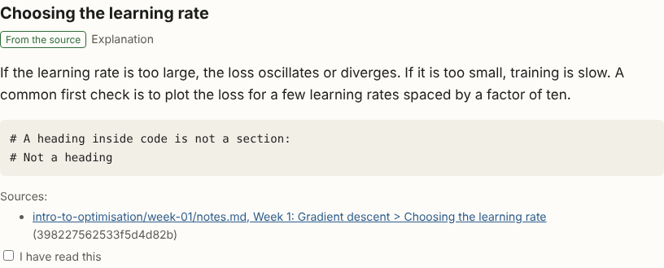

# Study rooms

Each section quotes its source and lists the passages it cites:



```bash
python -m studybuddy import sample_course
python -m studybuddy room intro-to-optimisation 1
# Open .studybuddy/rooms/intro-to-optimisation/week-01/index.html
```

- **Format.** A room is JSON checked against `studybuddy/room/schema.json`:
  chapters (one per file) made of sections. Each section has a kind
  (setup, symbols, explanation, worked example, common mistakes, quiz, or
  summary), the chunk IDs it cites, and a provenance: `source` (quoted
  from the cited passages) or `generated` (written by a model and only
  supported by them). `coverage` maps every passage of the week to the
  sections that use it, so you can see what a room leaves out.
- **Builder.** The built-in builder (`extractive-v1`) uses no model. It
  only quotes your files, so every section is `source`. Its quiz asks
  which part of a file says a quoted sentence.
- **Model-written sections.** `python -m studybuddy room <course> <week> --generate`
  (needs `ollama serve` and `ollama pull mistral`; pick another with
  `--model`) sends each chapter's passages to the local model and adds
  the setup, worked example, common mistakes, and quiz sections it writes.
  They are marked "Generated" and may cite only that chapter's passages.
  A reply that fails the checks is retried once with the problems listed;
  if it still fails, that chapter keeps only its quoted sections and the
  command says why. Generated section IDs come from the chapter and the
  section's kind and order, so progress and edits survive a rebuild.
- **Your own room JSON**, for example from a local model:
  `python -m studybuddy room <course> <week> --from-json room.json`. It is
  checked against the schema and the library (unknown citations,
  duplicate IDs, quiz answers out of range, passages missing from
  `coverage`). If it fails, the command lists each problem with its JSON
  path, exits with code 2, and keeps the last good room.
- **Stable IDs, progress, and edits.** Section IDs come from where a
  passage lives (file, page, heading path, or notebook cell), not from its
  text, so rebuilding after you edit your notes keeps them. A repeated
  heading or cell ID is numbered by order. A notebook cell without an ID
  (older notebooks) is placed by the nearest heading above it, so adding a
  cell under another heading does not move it; adding one under the same
  heading does. Progress lives
  in `progress.json` and your own text in `edits.json`, next to the room;
  a rebuild never rewrites them. The page saves ticks and quiz answers in
  the browser, and "Export progress" downloads them as `progress.json`.
  `edits.json` maps a section ID to a new `title` or `blocks`.
- **Safety.** All course text is escaped. Notebook code is shown as text
  and never run.
- **Screenshots** of the sample course's week 1 room:
  [phone](images/room-phone.png), [desktop](images/room-desktop.png).
- **Browser check** (needs Playwright with Chromium):
  `python scripts/check_room_page.py <room>/index.html` checks phone and
  desktop widths, keyboard access, that progress survives a reload and
  exports, and that citations open their section. `--shots DIR` saves
  screenshots; use it on the public sample course only.
